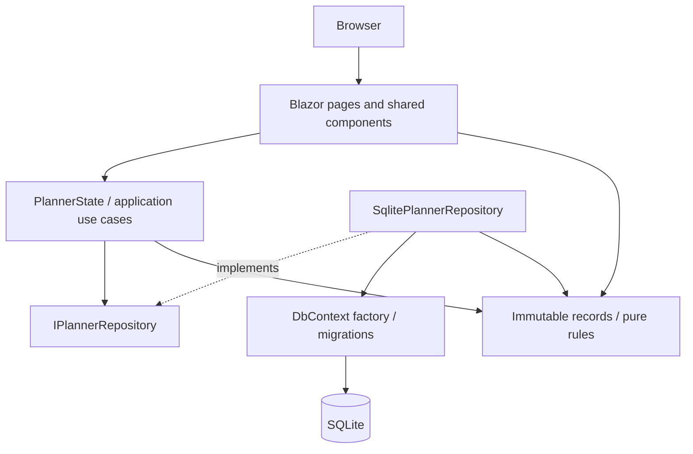
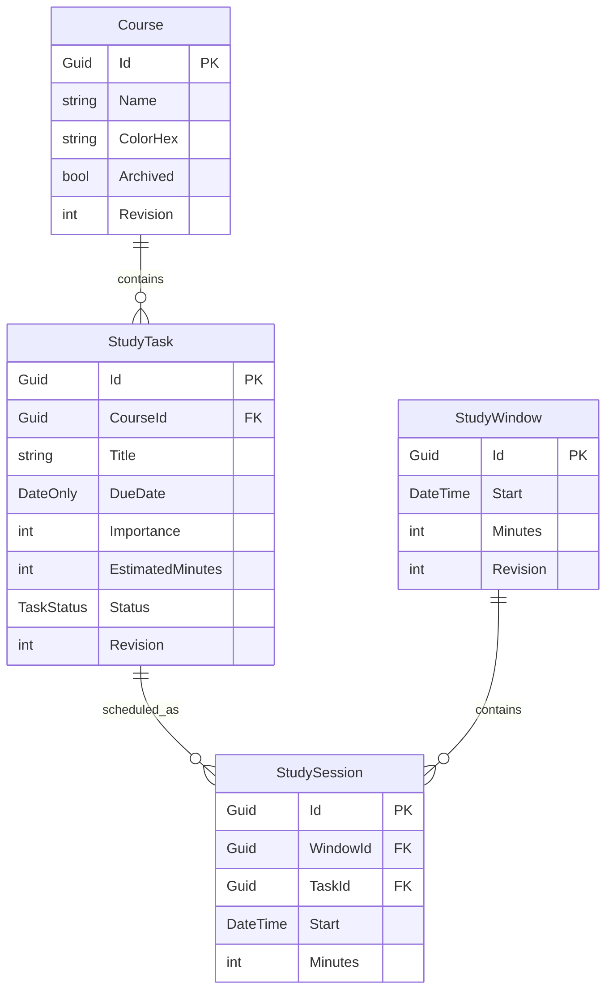

# Architecture and design decisions

The Web project references Infrastructure only to wire dependencies in Program. Components call PlannerState, not EF. Application and Domain do not depend on Infrastructure or ASP.NET. A single repository contract keeps course/task operations and consistent snapshots together; separate interfaces would add little to this small aggregate.

## Data model

Course deletion is restricted when tasks exist. Archive preserves all links and historical status. New tasks cannot be assigned to archived courses; existing linked tasks remain editable/completable. Each update increments Revision; EF includes the old Revision in its write condition. A stale edit or delete produces a recoverable error instead of silent data loss. After conflict, refresh/reopen the edit form to use the latest revision.

## Functional core and imperative shell

`TaskRules.Create` receives IDs explicitly, so identical inputs produce equal results. Application generates new IDs at the I/O boundary. Models are sealed records; edits and status transitions use `with` and never mutate the old value. Pure functions receive `DateOnly today`; Web owns the clock. `Result<T>` has a private constructor and success/failure factories, plus `Map` and `Bind` for transformation and short-circuiting.

Priority is `urgency × wu + importance × 12 × wi + min(hours,12) × 1.5 × ww`; urgency is 75 when overdue, otherwise `60/(days+1)`. All weights are finite in [0,3], at least one nonzero. Done tasks score zero and are excluded from recommendations. Ties resolve by due date, ordinal-ignore-case title, then ID. The explanation sums the same unrounded components used in the final rounded total. This is an explainable heuristic, not a validated prediction.

Analytics uses LINQ/lookup/aggregation over immutable snapshots. It reports current status, not fabricated completion history. Scheduling ranks once and consumes explicit slots, reporting leftover estimates. Internally a private list/dictionary is used for efficient construction; no input or external state is mutated, and output is deterministic. Local mutation does not make an externally referentially transparent function impure. Overdue work is left unallocated; users must revisit its deadline. No claim is made that a proposal is an optimal schedule.

## State and storage lifecycle

PlannerState is scoped to one Blazor circuit; database storage is shared. Busy state prevents overlapping commands in a circuit. Writes validate, commit, reload an authoritative snapshot, and then announce success. Failure keeps form input and displays a useful error. Other circuits refresh explicitly; this is not real-time collaborative sync.

Each repository operation creates/disposes its own DbContext using a factory; long-lived Blazor circuits do not hold an EF change tracker. A transaction protects course checks and writes; a read transaction makes the course/task snapshot consistent. Foreign keys, check constraints, and indexes reinforce domain validation. Migrations use a generated fixed snapshot, not EnsureCreated. Add future migrations with `dotnet ef migrations add Name --project src/StudyFlow.Infrastructure` after changing the model; the design-time factory is for tooling, not the production data path.

Interactive prerendering is disabled for the planner: controls appear when their event handlers are ready, and loading is not duplicated during static rendering/hydration. This trades initial server-rendered content for a reliable interactive form flow. Static asset manifests are enabled for local `dotnet run` in production mode as well as publish output.

## Boundaries and tradeoffs

UI pagination bounds rendered cards, but the repository currently loads all records. SQLite serializes writers; large multi-user operation needs account isolation, server-side paging and a server database. No authentication is claimed. JSON backup import uses a validated, conflict-safe merge in one transaction; it never overwrites existing IDs with different data. Restoring a backup to an empty database recreates its domain records and schedule; revisions reset to zero for new records. It is not an exact replacement of an existing database. A database backup requires stopping the app before copying its SQLite file (or an SQLite-aware backup), because WAL writes may still be pending.

## Persistent scheduling and backup boundary

`StudyWindow(Id, Start, Minutes, Revision)` stores availability. `StudySession(Id, WindowId, TaskId, Start, Minutes)` stores an explicitly accepted plan. Both use immutable domain records. SQLite foreign keys cascade session deletion when a window/task is removed. Migration PersistentSchedule adds tables/indexes without altering original records; upgrade preservation is integration-tested.

Saving a proposal compares the current tasks, windows and saved sessions against the caller's snapshot inside the transaction. A stale snapshot rejects the operation. It then validates bounds, overlap, deadlines, task status and estimated capacity, deletes the old sessions and inserts the new ones in the same transaction. A test injects an SQLite trigger failure to prove the old plan is restored after rollback. Past windows remain stored but do not participate in new proposals. Saved sessions intentionally represent an accepted snapshot: later status/deadline edits do not rewrite historical sessions. New proposals replace the entire plan only with explicit UI confirmation.

`BackupCodec` in Application handles serialization and pure structural/domain validation. Repository ImportAsync revalidates typed snapshots, checks live ID conflicts and validates the combined schedule before writes. A single transaction includes courses, tasks, windows and sessions. Identical records are ignored, different records with the same ID reject the entire import, and revision metadata is excluded from content comparisons. New imports start at revision zero; existing revisions are untouched. No clock/database is consulted during parsing; past saved schedules remain valid backups. See BACKUP_FORMAT.md for schema and limits.
